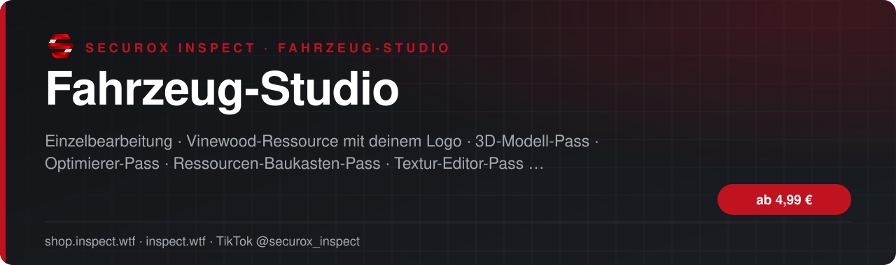
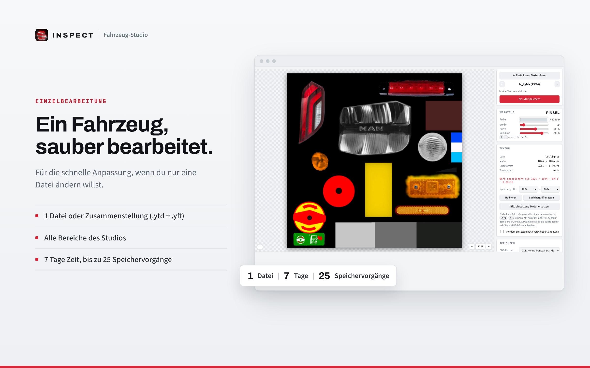
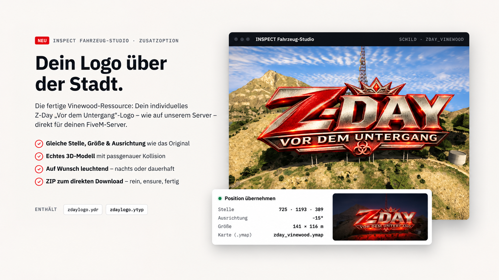
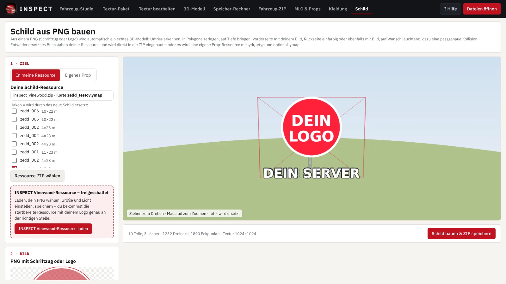
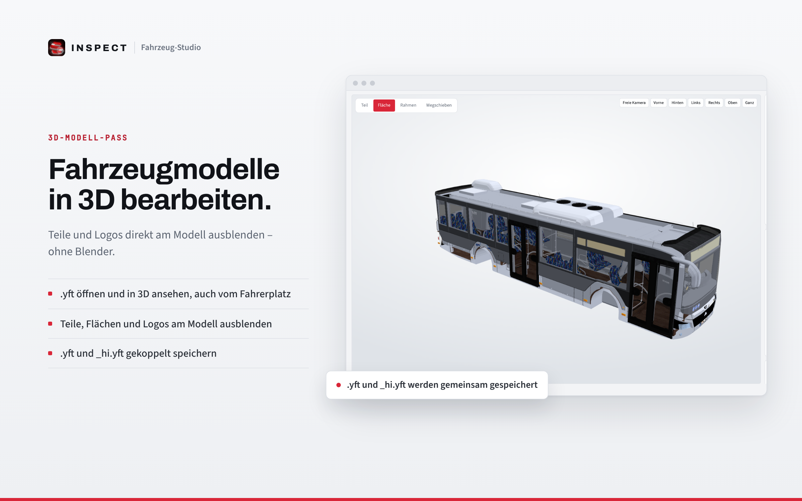
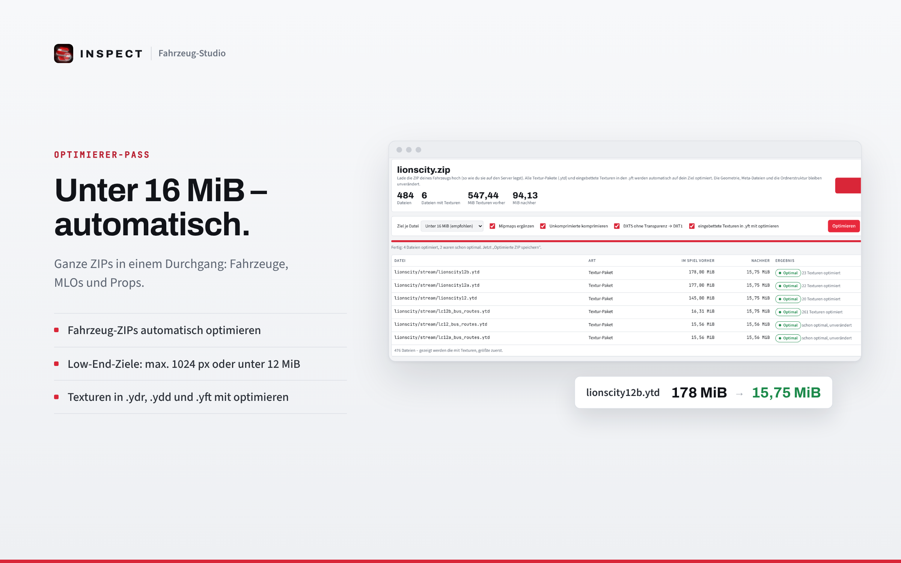

<!-- inspect-showcase: automatisch erzeugt, Änderungen bitte im Shop vornehmen -->

  
  
  

  
  
  

 

> 🇬🇧 **English:** Fahrzeug-Studio – browser-based FiveM vehicle editor for .ytd/.yft files – textures, 3D models and optimisation by SecuroX Inspect. Purchase and licensing exclusively at [shop.inspect.wtf](https://shop.inspect.wtf). Product details below are in German – questions are welcome on [Discord](https://discord.gg/inspect).

 

## Überblick

Der Komplett-Pass schaltet das gesamte INSPECT Fahrzeug-Studio frei – für beliebig viele Dateien während der gewählten Laufzeit.

Enthalten sind alle Bereiche: Textur-Editor (.ytd öffnen und bearbeiten, Logos entfernen, Liveries, Bilder und Schriftzüge einsetzen), 3D-Modell (.yft ansehen, Teile ausblenden, _hi.yft gekoppelt speichern), Optimierer (Fahrzeug-ZIPs, MLOs und Props automatisch unter 16 MiB) und Ressourcen-Baukasten (Kleidungs-Ressourcen und Schilder aus PNG als fertige FiveM-Ressource).

Ideal für Server-Teams und Entwickler, die regelmäßig Fahrzeuge einbauen und ihren Server sauber halten wollen. Kaufst du vor Ablauf erneut, verlängert sich der Pass nahtlos.

## Produkte & Preise

| Produkt | Wofür | Preis | |
|:--|:--|--:|:--:|
| **Einzelbearbeitung** | Eine Datei im INSPECT Fahrzeug-Studio bearbeiten und speichern – ideal, wenn du nur ein Fahrzeug anpassen willst. | 4,99 € | [Kaufen](https://shop.inspect.wtf/produkt/fahrzeug-studio-einzelbearbeitung) |
| **Vinewood-Ressource mit deinem Logo** | Keine eigene Schild-Ressource? Die fertige INSPECT Vinewood-Ressource – das Studio setzt dein Logo ein, du lädst sie startbereit herunter. | 9,99 € | [Kaufen](https://shop.inspect.wtf/produkt/fahrzeug-studio-vinewood-ressource) |
| **3D-Modell-Pass** | FiveM-Fahrzeugmodelle (.yft) in 3D bearbeiten: Teile und Logos am Modell ausblenden, _hi.yft gekoppelt speichern. | ab 20,00 € | [Kaufen](https://shop.inspect.wtf/produkt/fahrzeug-studio-3d-modell-pass) |
| **Custom-Prop-Pass** | Eigene Props aus Spawnname und PNG-Design bauen – als Custom- oder Replace-Ressource, sofort performant. | ab 20,00 € | [Kaufen](https://shop.inspect.wtf/produkt/fahrzeug-studio-custom-prop-pass) |
| **Optimierer-Pass** | FiveM-Fahrzeuge, MLOs und Props automatisch unter 16 MiB bringen – ganze ZIPs in einem Durchgang. | ab 20,00 € | [Kaufen](https://shop.inspect.wtf/produkt/fahrzeug-studio-optimierer-pass) |
| **Ressourcen-Baukasten-Pass** | Kleidungs-Ressourcen und Schilder aus PNG als fertige, startbereite FiveM-Ressource bauen. | ab 20,00 € | [Kaufen](https://shop.inspect.wtf/produkt/fahrzeug-studio-ressourcen-pass) |
| **Textur-Editor-Pass** | Texturen von FiveM-Fahrzeugen bearbeiten: .ytd öffnen, Logos entfernen, Liveries, Bilder und Schriftzüge einsetzen. | ab 20,00 € | [Kaufen](https://shop.inspect.wtf/produkt/fahrzeug-studio-textur-editor-pass) |
| **Verschlüsselungs-Pass** | FiveM-Lua-Scripts verschlüsseln – maximale Sicherheit, bleibt für FiveM lesbar. | ab 25,00 € | [Kaufen](https://shop.inspect.wtf/produkt/fahrzeug-studio-verschluesselung-pass) |
| **Komplett-Pass** ⭐ Empfehlung | Alle Funktionen des INSPECT Fahrzeug-Studios ohne Einschränkung – für beliebig viele Fahrzeuge, Props und Ressourcen. | ab 35,00 € | [Kaufen](https://shop.inspect.wtf/produkt/fahrzeug-studio-komplett-pass) |

## Kompatibilität

| | |
|:--|:--|
| Plattform | FiveM (GTA V) |

## Einblicke

<table>
  <tr>
    <td width="50%"></td>
    <td width="50%"></td>
  </tr>
  <tr>
    <td width="50%"></td>
    <td width="50%"></td>
  </tr>
  <tr>
    <td width="50%"></td>
    <td width="50%"></td>
  </tr>
</table>

## In Aktion sehen

- 🎞️ Videos zu Fahrzeug-Studio – Vinewood-Ressource mit deinem Logo direkt auf der [Produktseite im Shop](https://shop.inspect.wtf/produkt/fahrzeug-studio-vinewood-ressource)
- 🎞️ Videos zu Fahrzeug-Studio – Optimierer-Pass direkt auf der [Produktseite im Shop](https://shop.inspect.wtf/produkt/fahrzeug-studio-optimierer-pass)
- 🎞️ Videos zu Fahrzeug-Studio – Komplett-Pass direkt auf der [Produktseite im Shop](https://shop.inspect.wtf/produkt/fahrzeug-studio-komplett-pass)

Neue Clips und Vorschauen regelmäßig auf TikTok: **[@securox_inspect](https://www.tiktok.com/@securox_inspect)**

## Details zu den Produkten

<b>Einzelbearbeitung</b> · 4,99 €

 

Mit der Einzelbearbeitung schaltest du im INSPECT Fahrzeug-Studio genau eine Datei bzw. Dateizusammenstellung frei – zum Beispiel ein Fahrzeug mit seiner .ytd und .yft oder eine Fahrzeug-ZIP.

Du kannst diese Datei 7 Tage lang in allen Bereichen des Studios bearbeiten und bis zu 25-mal speichern: Logos entfernen, Liveries und Schriftzüge einsetzen, Teile am Modell ausblenden oder alles automatisch unter 16 MiB bringen.

So funktioniert es: Datei im Studio öffnen, auf „Bearbeiten“ klicken und die Einzelbearbeitung einlösen. Ab dann ist diese Datei freigeschaltet. Für eine andere Datei brauchst du eine neue Einzelbearbeitung – oder du nimmst einen Pass mit beliebig vielen Dateien.

- 1 Datei bzw. Dateizusammenstellung (z. B. .ytd + .yft) freischalten
- Alle Bereiche des Studios für diese Datei
- 7 Tage bearbeiten, bis zu 25 Speichervorgänge
- Bearbeitete Dateien 7 Tage im Kundenkonto abrufbar
- Originaldateien bleiben auf deinem Rechner
- Läuft im Browser – ohne Blender, ohne OpenIV, ohne Installation

**4,99 €** &nbsp;–&nbsp; einmaliger Kaufpreis · Download und Lizenz im Kundenkonto

**[➜ Einzelbearbeitung im Shop kaufen](https://shop.inspect.wtf/produkt/fahrzeug-studio-einzelbearbeitung)**

<b>Vinewood-Ressource mit deinem Logo</b> · 9,99 €

 

Du willst deinen Servernamen oder dein Logo statt der Vinewood-Buchstaben über der Stadt, hast aber keine passende Ressource? Dann nimm unsere fertige INSPECT Vinewood-Ressource.

So läuft es: Im Fahrzeug-Studio im Bereich „Schild“ auf „Fertige Vinewood-Ressource verwenden“ klicken – die Ressource wird direkt geladen. Dann dein PNG wählen, Größe, Tiefe und Licht einstellen und speichern. Du bekommst die komplette, startbereite FiveM-Ressource mit deinem Logo als ZIP zum direkten Download: in den resources-Ordner legen, ensure eintragen, fertig.

Die Ressource ist dauerhaft in deinem Konto freigeschaltet – du kannst dein Schild jederzeit neu bauen, zum Beispiel wenn sich dein Logo ändert. Zum Speichern brauchst du zusätzlich eine Einzelbearbeitung oder den Ressourcen-Baukasten-Pass (bzw. Komplett-Pass).

- Fertige Vinewood-Ressource, im Studio mit einem Klick geladen
- Dein Logo oder Servername als 3D-Buchstaben mit Kollision
- Position am Hügel ist schon eingestellt
- Auf Wunsch nachts oder dauerhaft leuchtend
- Startbereite Ressource als ZIP zum direkten Download
- Dauerhaft im Konto – Schild jederzeit neu bauen
- Nutzung auf deinen eigenen Servern, kein Weiterverkauf
- Zum Speichern: Einzelbearbeitung oder Ressourcen-/Komplett-Pass

**9,99 €** &nbsp;–&nbsp; einmaliger Kaufpreis · Download und Lizenz im Kundenkonto

**[➜ Vinewood-Ressource mit deinem Logo im Shop kaufen](https://shop.inspect.wtf/produkt/fahrzeug-studio-vinewood-ressource)**

<b>3D-Modell-Pass</b> · ab 20,00 €

 

Der 3D-Modell-Pass schaltet den 3D-Bereich des INSPECT Fahrzeug-Studios frei – für beliebig viele Dateien während der Laufzeit.

Öffne .yft-Modelle, sieh sie dir aus jeder Perspektive an – auch vom Fahrerplatz – und blende Teile, Flächen oder Logos gezielt aus. Lädst du die passende _hi.yft dazu, werden alle Änderungen automatisch in beiden Dateien übernommen. Die passende .ytd kann für eine originalgetreue Vorschau mitgeladen werden.

- .yft öffnen und in 3D ansehen, auch vom Fahrerplatz
- Teile, Flächen und Logos am Modell ausblenden
- .yft und _hi.yft gekoppelt bearbeiten und speichern
- Beliebig viele Dateien während der Laufzeit
- Bearbeitete Dateien 7 Tage im Kundenkonto abrufbar
- Originaldateien bleiben auf deinem Rechner
- Läuft im Browser – ohne Blender, ohne OpenIV, ohne Installation

| Laufzeit | Preis |
|:--|--:|
| 1 Tag | **20,00 €** |
| 7 Tage | **42,99 €** |
| 30 Tage | **59,99 €** |

**[➜ 3D-Modell-Pass im Shop kaufen](https://shop.inspect.wtf/produkt/fahrzeug-studio-3d-modell-pass)**

<b>Custom-Prop-Pass</b> · ab 20,00 €

 

Der Custom-Prop-Pass schaltet den Custom-Prop-Bereich des INSPECT Fahrzeug-Studios frei – für beliebig viele Props während der Laufzeit.

Gib einen Spawnnamen ein, lade dein PNG-Design hoch und bekomme eine fertige, performante FiveM-Ressource zurück. Du wählst zwischen „Custom“ (neuer, eigener Prop mit eigenem Namen) und „Replace“ (ersetzt einen vorhandenen Prop).

Alles läuft im Browser – ohne OpenIV, ohne Blender, ohne Installation. Bearbeitete Dateien liegen 7 Tage in deinem Kundenkonto zum Abruf bereit, deine Originaldateien bleiben auf deinem Rechner.

- Eigene Props aus Spawnname + PNG-Design bauen
- Custom (eigener Prop) oder Replace (vorhandenen ersetzen)
- Sofort performant und sauber in FiveM nutzbar
- Beliebig viele Props während der Laufzeit
- Bearbeitete Dateien 7 Tage im Kundenkonto abrufbar
- Originaldateien bleiben auf deinem Rechner
- Läuft im Browser – ohne OpenIV, ohne Blender, ohne Installation

| Laufzeit | Preis |
|:--|--:|
| 1 Tag | **20,00 €** |
| 7 Tage | **42,99 €** |
| 30 Tage | **59,99 €** |

**[➜ Custom-Prop-Pass im Shop kaufen](https://shop.inspect.wtf/produkt/fahrzeug-studio-custom-prop-pass)**

<b>Optimierer-Pass</b> · ab 20,00 €

 

Der Optimierer-Pass schaltet die Optimierungs-Bereiche des INSPECT Fahrzeug-Studios frei – für beliebig viele Dateien während der Laufzeit.

Ziehe eine komplette Fahrzeug-Ressource als ZIP hinein und erhalte sie optimiert zurück: zu große Texturen werden verkleinert, platzsparende Formate gewählt und fehlende Mipmaps ergänzt – Ziel: unter 16 MiB, ohne Streaming-Warnungen in der FiveM-Konsole. Für MLOs und Props werden auch Texturen in .ydr, .ydd und .yft mit optimiert.

Auch für schwächere PCs: Mit dem Ziel „Unter 12 MiB“ oder „höchstens 1024 px“ machst du Fahrzeuge in einem Klick low-end-freundlich – sie laden schneller und Texturen flackern nicht mehr.

- Fahrzeug-ZIPs automatisch optimieren
- Low-end-freundlich: Ziel „höchstens 1024 px“ oder „unter 12 MiB“ für schwächere PCs
- MLOs und Props: Texturen in .ydr, .ydd und .yft mit optimieren
- Ziel unter 16 MiB oder unter 12 MiB mit Reserve
- Mipmaps ergänzen, DXT5 ohne Transparenz → DXT1
- Beliebig viele Dateien während der Laufzeit
- Bearbeitete Dateien 7 Tage im Kundenkonto abrufbar
- Originaldateien bleiben auf deinem Rechner
- Läuft im Browser – ohne Blender, ohne OpenIV, ohne Installation

| Laufzeit | Preis |
|:--|--:|
| 1 Tag | **20,00 €** |
| 7 Tage | **42,99 €** |
| 30 Tage | **59,99 €** |

**[➜ Optimierer-Pass im Shop kaufen](https://shop.inspect.wtf/produkt/fahrzeug-studio-optimierer-pass)**

<b>Ressourcen-Baukasten-Pass</b> · ab 20,00 €

 

Der Ressourcen-Baukasten-Pass schaltet die Ressourcen-Bereiche des INSPECT Fahrzeug-Studios frei – für beliebig viele Dateien während der Laufzeit.

Kleidung: Aus Kleidungs-ZIPs eine fertige Kleidungs-Ressource für männlich oder weiblich bauen oder neue Kleidung zu einer bestehenden Ressource hinzufügen – Texturen auf Wunsch gleich mit optimiert.

Schild: Aus einem PNG mit Schriftzug oder Logo ein fertiges FiveM-Prop erzeugen – ausgeschnitten oder als Tafel, einfarbig oder mit Bild, auf Wunsch nachts oder dauerhaft leuchtend und direkt auf der Karte platziert (.ymap).

Beliebt: dein eigenes Vinewood-Schild. PNG mit deinem Servernamen laden – das Studio baut daraus 3D-Buchstaben mit Kollision und ersetzt damit die Vinewood-Buchstaben am Hügel, die Position ist schon voreingestellt.

- Kleidungs-Ressourcen bauen (männlich/weiblich)
- Kleidung zu bestehender Ressource hinzufügen
- Schilder und Logos aus PNG als FiveM-Prop – z. B. eigener Servername statt der Vinewood-Buchstaben
- Leuchtend, auf der Karte platziert (.ymap)
- Beliebig viele Dateien während der Laufzeit
- Bearbeitete Dateien 7 Tage im Kundenkonto abrufbar
- Originaldateien bleiben auf deinem Rechner
- Läuft im Browser – ohne Blender, ohne OpenIV, ohne Installation

| Laufzeit | Preis |
|:--|--:|
| 1 Tag | **20,00 €** |
| 7 Tage | **42,99 €** |
| 30 Tage | **59,99 €** |

**[➜ Ressourcen-Baukasten-Pass im Shop kaufen](https://shop.inspect.wtf/produkt/fahrzeug-studio-ressourcen-pass)**

<b>Textur-Editor-Pass</b> · ab 20,00 €

 

Der Textur-Editor-Pass schaltet die Textur-Bereiche des INSPECT Fahrzeug-Studios frei – für beliebig viele Dateien während der Laufzeit.

Textur-Paket: .ytd-Dateien öffnen, alle Texturen mit Größe und Format sehen, einzelne Texturen ersetzen und das Paket automatisch unter 16 MiB bringen.

Textur bearbeiten: Logos mit Stempel, Muster und Zauberstab sauber entfernen, Bilder und Liveries einsetzen, Schriftzüge und Kennzeichen erzeugen und das passende DDS-Format wählen (DXT1, DXT5 oder unkomprimiert, mit Mipmaps).

- Textur-Paket (.ytd) öffnen, ersetzen und als .ytd speichern
- Logos entfernen mit Stempel, Muster und Zauberstab
- Bilder, Liveries, Schriftzüge und Kennzeichen einsetzen
- DDS-Formate DXT1/DXT5/unkomprimiert mit Mipmaps
- Beliebig viele Dateien während der Laufzeit
- Bearbeitete Dateien 7 Tage im Kundenkonto abrufbar
- Originaldateien bleiben auf deinem Rechner
- Läuft im Browser – ohne Blender, ohne OpenIV, ohne Installation

| Laufzeit | Preis |
|:--|--:|
| 1 Tag | **20,00 €** |
| 7 Tage | **42,99 €** |
| 30 Tage | **59,99 €** |

**[➜ Textur-Editor-Pass im Shop kaufen](https://shop.inspect.wtf/produkt/fahrzeug-studio-textur-editor-pass)**

<b>Verschlüsselungs-Pass</b> · ab 25,00 €

 

Der Verschlüsselungs-Pass schaltet den Verschlüsseln-Bereich des INSPECT Fahrzeug-Studios frei – für beliebig viele Scripts während der Laufzeit.

Zieh eine .lua oder eine ganze Ressourcen-ZIP hinein und erhalte sie sauber verschlüsselt zurück. Das System erkennt selbst, welche Dateien verschlüsselt werden dürfen (Manifest, Config und NUI-Dateien bleiben lesbar), und wenn du FiveM angibst, bleibt alles nativ lesbar.

Vier Stufen – von „Leicht“ (nur Namen, kein Laufzeit-Overhead) bis „Maximal“ mit Kontrollfluss-Verschleierung für höchste Sicherheit. Alles läuft im Browser, eigenständig, ohne Server-Abhängigkeit. Bearbeitete Dateien liegen 7 Tage in deinem Kundenkonto bereit, deine Originaldateien bleiben auf deinem Rechner.

- FiveM-Lua-Scripts verschlüsseln/obfuskieren
- Vier Stufen: Leicht, Mittel, Stark, Maximal (Kontrollfluss-Verschleierung)
- Erkennt selbst, was verschlüsselt werden darf (Manifest/Config/NUI bleiben lesbar)
- Einzelne .lua oder ganze Ressourcen-ZIP in einem Durchgang
- Bleibt für FiveM nativ lesbar – eigenständig, ohne Server-Abhängigkeit
- Beliebig viele Scripts während der Laufzeit
- Bearbeitete Dateien 7 Tage im Kundenkonto abrufbar
- Originaldateien bleiben auf deinem Rechner
- Läuft im Browser – ohne Installation

| Laufzeit | Preis |
|:--|--:|
| 1 Tag | **25,00 €** |
| 7 Tage | **49,99 €** |
| 30 Tage | **69,99 €** |

**[➜ Verschlüsselungs-Pass im Shop kaufen](https://shop.inspect.wtf/produkt/fahrzeug-studio-verschluesselung-pass)**

<b>Komplett-Pass</b> · ab 35,00 €

 

Der Komplett-Pass schaltet das gesamte INSPECT Fahrzeug-Studio frei – für beliebig viele Dateien während der gewählten Laufzeit.

Enthalten sind alle Bereiche: Textur-Editor (.ytd öffnen und bearbeiten, Logos entfernen, Liveries, Bilder und Schriftzüge einsetzen), 3D-Modell (.yft ansehen, Teile ausblenden, _hi.yft gekoppelt speichern), Optimierer (Fahrzeug-ZIPs, MLOs und Props automatisch unter 16 MiB) und Ressourcen-Baukasten (Kleidungs-Ressourcen und Schilder aus PNG als fertige FiveM-Ressource).

Ideal für Server-Teams und Entwickler, die regelmäßig Fahrzeuge einbauen und ihren Server sauber halten wollen. Kaufst du vor Ablauf erneut, verlängert sich der Pass nahtlos.

- Alle Funktionen des Fahrzeug-Studios
- Beliebig viele Dateien während der Laufzeit
- Textur-Editor, 3D-Modell, Optimierer und Ressourcen-Baukasten
- Verlängerung schließt nahtlos an
- Bearbeitete Dateien 7 Tage im Kundenkonto abrufbar
- Originaldateien bleiben auf deinem Rechner
- Läuft im Browser – ohne Blender, ohne OpenIV, ohne Installation

| Laufzeit | Preis |
|:--|--:|
| 1 Tag | **35,00 €** |
| 7 Tage | **72,00 €** |
| 30 Tage | **149,99 €** |

**[➜ Komplett-Pass im Shop kaufen](https://shop.inspect.wtf/produkt/fahrzeug-studio-komplett-pass)**

Sichere Zahlung mit PayPal oder Kreditkarte · Rechnung als PDF · Support auf Deutsch

## So einfach geht's

1. **Im Shop kaufen** – sicher bezahlen mit PayPal oder Kreditkarte.
2. **Sofort loslegen** – Download und Lizenz stehen direkt nach Zahlungseingang in deinem Kundenkonto bereit, die Rechnung erhältst du als PDF.
3. **Einrichten** – bei Fragen hilft dir unser Support im Discord weiter.

## Warum INSPECT?

<table>
  <tr>
    <td width="50%" valign="top"><b>🇩🇪 Entwickelt in Deutschland</b> Konzeption, Entwicklung und Support aus einer Hand.</td>
    <td width="50%" valign="top"><b>💬 Persönlicher Support</b> Schnelle Hilfe auf Deutsch im INSPECT Discord.</td>
  </tr>
  <tr>
    <td width="50%" valign="top"><b>🔒 Sichere Zahlung</b> PayPal oder Kreditkarte, Rechnung automatisch als PDF.</td>
    <td width="50%" valign="top"><b>⚡ Sofort verfügbar</b> Download und Lizenz direkt nach der Zahlung im Kundenkonto.</td>
  </tr>
</table>

## Häufige Fragen

<b>Wie erhalte ich das Produkt?</b>

 

Nach bestätigter Zahlung stehen Download und Lizenz in deinem Kundenkonto bereit. Die Rechnung erhältst du als PDF.

<b>Wie funktionieren die Laufzeiten?</b>

 

Du wählst beim Kauf die passende Laufzeit. Die Lizenz ist danach sofort aktiv und in deinem Kundenkonto einsehbar.

<b>Bekomme ich Hilfe bei der Einrichtung?</b>

 

Ja – unser Support hilft dir im [INSPECT Discord](https://discord.gg/inspect) persönlich und auf Deutsch.

<b>Wo kaufe ich offiziell?</b>

 

Ausschließlich im INSPECT Shop unter [shop.inspect.wtf](https://shop.inspect.wtf). Angebote von Dritten stammen nicht von uns.

## Kontakt

| | |
|:--|:--|
| 🛒 Shop | [shop.inspect.wtf](https://shop.inspect.wtf) |
| 🌐 Website | [inspect.wtf](https://inspect.wtf) |
| 💬 Discord | [discord.gg/inspect](https://discord.gg/inspect) |
| 🎬 TikTok | [@securox_inspect](https://www.tiktok.com/@securox_inspect) |
| ✉️ E-Mail | [info@inspect.wtf](mailto:info@inspect.wtf) |

---

<b>SecuroX Inspect</b> · Offizielle Produktpräsentation · Dieses Repository enthält keinen Quellcode und keine Produktdateien. 
Kauf und Lizenzen ausschließlich über <a href="https://shop.inspect.wtf">shop.inspect.wtf</a> · Inhalte werden automatisch aus dem Shop aktualisiert.

